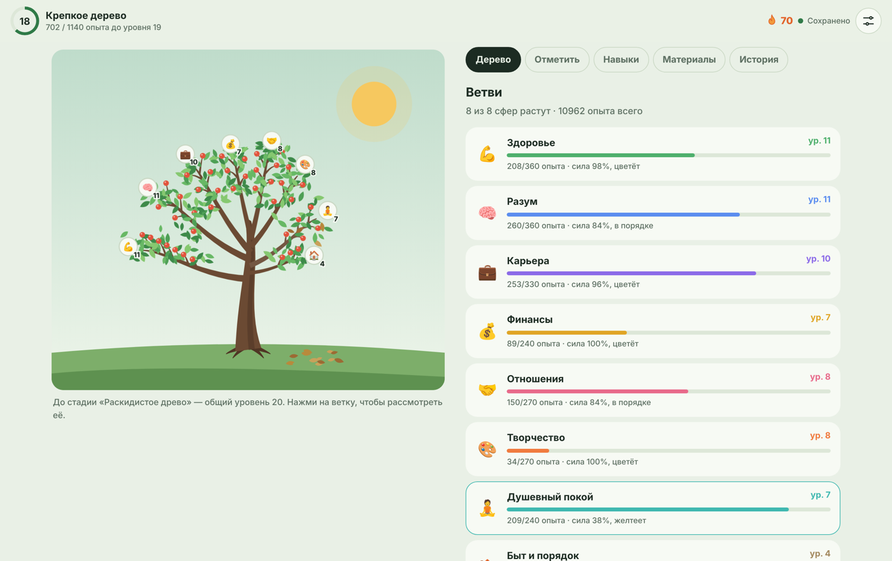

# Древо жизни

Игра для саморазвития. В играх прогресс виден сразу, а в жизни — нет. Здесь каждое полезное дело из реальной жизни растит ветвь дерева, а вредные привычки заставляют листья желтеть и опадать.



## Как устроена игра

- **8 ветвей — 8 сфер жизни:** здоровье, разум, карьера, финансы, отношения, творчество, душевный покой, быт.
- **Полезные дела** дают опыт ветви. Ветвь становится длиннее, на ней появляются листья. Повтор одного дела за день даёт меньше опыта (100% → 50% → 20%), чтобы нельзя было «нафармить» уровень.
- **Огоньки:** если делать одно дело несколько дней подряд, у него загорается огонёк со счётчиком дней. На 3, 7, 14, 30, 60, 100 и 365 день — бонус опыта. Пропущенный день гасит огонёк. За нужными делами можно «следить», чтобы их огоньки всегда были на виду.
- **Подветви:** любую ветвь можно разделить на свои части — например, «Разум» на предметы в вузе. Нажми на ветку, и камера приблизится к ней: видно, как она делится, а длина и густота каждой подветви показывают, сколько в неё вложено. Время отмечается в минутах (час ≈ 24 опыта, после 3 часов в день по одной подветви опыт идёт медленнее). Панель сравнивает подветви за неделю, месяц и всё время и подсказывает, что давно заброшено — такие подветви желтеют. Свои дела можно привязать к подветви.
- **Заметки и дневник:** к любой отметке можно написать заметку и выбрать настроение — сразу после отметки (плашка «Добавить заметку») или кнопкой ✎ в истории. Во вкладке «История → Дневник» все заметки собраны по дням, с поиском, фильтром по сферам и выгрузкой в текстовый файл. Последние заметки видны и в меню подветви.
- **Обучение:** при первом входе игроку показывают, как всё устроено: экран затемняется, нужная часть интерфейса подсвечивается, обучение само переключает вкладки и приближает ветку. Если в игре появилась новая функция, игрок, уже прошедший обучение, увидит короткий тур «Что нового» только по ней. Пройти обучение заново можно в настройках.
- **Два языка — русский и английский:** переводится всё — интерфейс, обучение, сферы, дела, привычки, навыки, сообщения сервера и Telegram-бота. Язык выбирается сам по языку браузера или Telegram, переключается в настройках и на экране входа и сохраняется в аккаунте. Для англоязычных игроков русскоязычные сайты в «Материалах» заменены на англоязычные аналоги.
- **Навыки** — реальные достижения («пробежать 5 км», «составить бюджет»). Каждый освоенный навык — новая веточка с плодом и бонус опыта. Навыки открываются по уровню ветви и по цепочке.
- **Вредные привычки** отнимают у ветвей жизненную силу. Листья желтеют и падают на землю, а ветвь растёт медленнее (до половины скорости). Полезные дела её лечат.
- **Заброшенная ветвь** через 3 дня без дел начинает понемногу сохнуть.
- **Честность:** любую отметку можно отменить в «Истории». Всё состояние дерева вычисляется из журнала событий, поэтому после отмены дерево пересчитывается так, будто этого не было.
- **Материалы:** книги, курсы и сайты по каждой сфере. Отметка «Изучил» даёт опыт.
- **5 стилей оформления:** весенний сад, сакура, золотая осень, ночной неон, пиксель.
- **Аккаунты:** прогресс хранится на сервере и доступен с любого устройства.
- **Готово к Telegram:** есть вход через Telegram Mini App (нужно только создать бота).

## Устройство проекта

```
public/            — сайт (то, что видит игрок)
  index.html
  styles.css
  js/data.js       — содержимое игры: сферы, дела, привычки, навыки, материалы
  js/game.js       — правила: уровни, опыт, жизненная сила, откат
  js/tree.js       — рисование дерева (SVG) по прогрессу
  js/themes.js     — стили оформления
  js/app.js        — интерфейс: экраны, кнопки, сохранение
  js/api.js        — запросы к серверу
  js/sync.js       — слияние прогресса с разных устройств
  js/tour.js       — обучение и тур «Что нового»
  js/i18n.js       — языки: русский и английский
api/               — сервер (функции Vercel)
  auth.js          — регистрация и вход
  state.js         — загрузка и сохранение прогресса
  telegram.js      — вход из Telegram
  bot.js           — Telegram-бот: ответ на /start, кнопка «Открыть»
lib/               — общий код сервера: база данных, пароли, токены, связь аккаунтов
dev-server.js      — локальный сервер для запуска на своём компьютере
```

Без фреймворков и сборки: обычные HTML, CSS и JavaScript. Сервер использует только встроенные модули Node.js и драйвер базы `@neondatabase/serverless`.

## Запуск на своём компьютере

Нужен [Node.js](https://nodejs.org) версии 18 или новее.

```bash
node dev-server.js
```

Откройте http://localhost:3000. Без настройки данные сохраняются в файл `.data/db.json`.

## Публикация в интернете бесплатно (Vercel + Neon)

1. Зайдите на [vercel.com](https://vercel.com) и войдите через GitHub (тариф Hobby бесплатный).
2. Нажмите **Add New → Project**, выберите репозиторий `life_and_progress` и нажмите **Deploy**. Ничего настраивать не нужно.
3. Подключите базу данных: в проекте откройте вкладку **Storage → Create Database → Neon** (бесплатный тариф), согласитесь и подключите базу к проекту. Vercel сам добавит переменную `DATABASE_URL`.
4. Откройте **Settings → Environment Variables** и добавьте `AUTH_SECRET` — любую длинную случайную строку (например, 40 случайных букв и цифр).
5. Откройте **Deployments**, у последнего деплоя нажмите **⋯ → Redeploy**.

Готово: сайт работает по адресу вида `life-and-progress.vercel.app`. Таблицы в базе создадутся сами при первой регистрации. После каждого изменения в GitHub Vercel обновляет сайт автоматически.

Если при регистрации появляется сообщение «База данных не подключена» — значит, не выполнен шаг 3 или после него не сделан Redeploy.

## Telegram-приложение

Игра работает как Telegram Mini App: открывается внутри Telegram, вход без пароля, есть кнопка «Назад», вибрация при отметках, цвет шапки под выбранный стиль. Бот отвечает на /start кнопкой «Открыть моё дерево», а в чате с ботом появляется кнопка «Открыть».

Как подключить:

1. В Telegram напишите [@BotFather](https://t.me/BotFather), отправьте `/newbot`, придумайте имя и адрес бота (должен заканчиваться на `bot`). Скопируйте токен.
2. В Vercel: **Settings → Environment Variables** → добавьте `TELEGRAM_BOT_TOKEN` со значением токена → **Save**, затем **Deployments → ⋯ → Redeploy**.
3. Откройте в браузере `https://<ваш-сайт>.vercel.app/api/bot?setup=1`. Должно появиться `"ok": true` — бот подключён.
4. Необязательно: в @BotFather `/setuserpic` — аватарка бота, `/newapp` — отдельная ссылка вида `t.me/<бот>/<приложение>`.

### Связь аккаунтов сайта и Telegram

В настройках игры есть раздел «Аккаунт»:

- **На сайте → «Привязать Telegram».** Игра даёт ссылку на бота, игрок нажимает Start — Telegram привязан. Если игрок уже играл в Telegram, прогресс оттуда складывается с прогрессом на сайте.
- **В Telegram → «Вход по почте: Добавить».** К аккаунту из Telegram добавляются почта и пароль, и в него можно входить на сайте.
- **В Telegram → «Уже играю на сайте — объединить».** Вход по почте прямо в Telegram, прогресс двух аккаунтов складывается.
- **«Отвязать»** — Telegram отвязывается от аккаунта, прогресс остаётся.

Прогресс синхронизируется между устройствами: сервер складывает версии с разных устройств (журналы событий объединяются, отменённые отметки не возвращаются), а приложение подтягивает изменения, когда игрок к нему возвращается.

## Как дополнять игру

- **Перевод.** Тексты интерфейса переводятся на месте: `T('Русский текст', 'English text')` (см. `public/js/i18n.js`). У объектов игры в `data.js` английское название лежит в поле `en` (у материалов — `title_en`, `note_en`, `kind_en`).

- **Подсказка к новой функции** — в `public/js/tour.js`: добавьте функцию в `FEATURES` и её шаги в `STEPS` (`feature`, какой экран открыть — `nav`, что подсветить — `target`, заголовок и текст). Игроки увидят её в туре «Что нового» при следующем входе.

- Новое дело, привычку, навык или материал — допишите строку в `public/js/data.js`.
- Новый стиль — скопируйте блок в `public/js/themes.js` и поменяйте цвета.
- Правила (сколько опыта нужно на уровень, как быстро сохнут ветви) — в объекте `RULES` в `public/js/data.js`.
